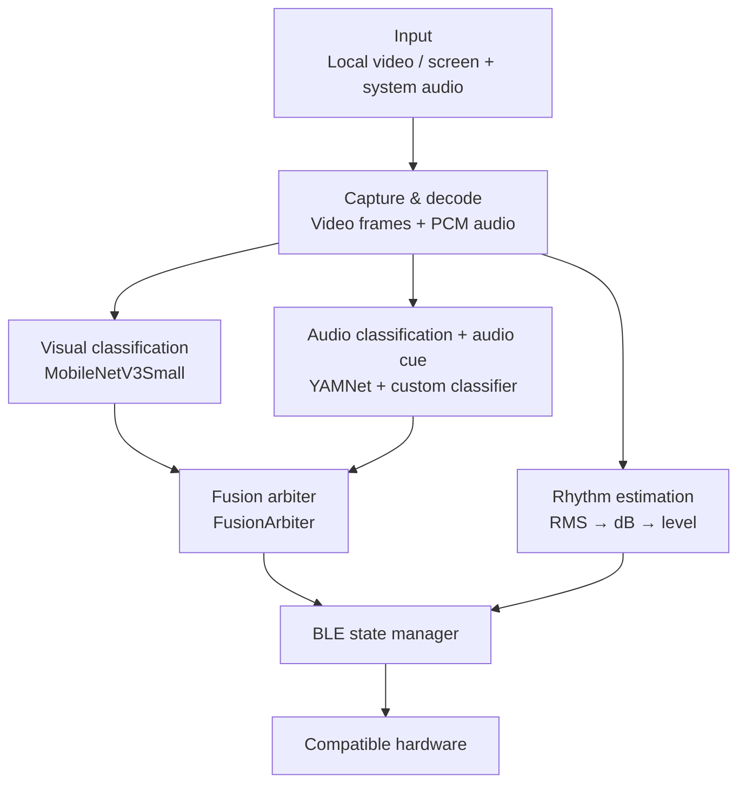

# Xcup Android

[中文](README.md) | **English**

Real-time video understanding with BLE device control, running on Android.

Xcup Android takes the picture and audio from a local video or from screen sharing, classifies the action and estimates its rhythm intensity on the device, then passes the results through a fusion arbiter and a state manager before sending control commands to compatible BLE hardware. The iOS app, [Xcup iOS](https://github.com/Tingfu-Zhou/Xcup-ios), is a port of this project.

This started as a personal project. As similar video-interaction features have become more common, I decided to open-source the code for developers interested in Android multimedia processing, on-device multimodal inference and real-time BLE control.

> This project deals with recognizing adult content and is intended for adults only. Use it in compliance with local laws, content licensing, privacy requirements and the rules of any third-party platforms involved.

## Features

- Local video analysis: import a video through the system file picker; the picture and audio are analyzed in sync with playback.
- Online analysis (Android 10+): captures the screen with `MediaProjection` and other apps' playback audio (where they allow it) with `AudioPlaybackCapture`. Black bars around the video are removed from screenshots, and the capture size follows screen rotation.
- On-device visual inference: MobileNetV3Small (LiteRT) classifies frames as plot, oral or sex. Each frame is preprocessed the same way as the training data (center square crop → 224 → 160).
- On-device audio inference: YAMNet plus a custom classifier detects the action. The same inference pass also reads YAMNet's built-in 521 AudioSet scores to derive an audio cue for that moment (dialog, music, quiet, unclear, vocal, impact, etc.).
- Rhythm intensity estimation: converts PCM loudness (RMS → dB), with smoothing and confidence checks, into discrete intensity levels.
- Multimodal fusion (`FusionArbiter` v2): starting, holding and stopping the motor are decided separately, and evidence is counted per new inference result. Starting needs agreement from both modalities or sustained audio evidence; holding needs support from either one. Audio cues are also used when starting: video may start the motor on its own when the audio is masked by background music, and when video is confident the scene is plot, audio false positives caused by dialog do not count.
- BLE control: automatic scanning, connection, protocol frame encoding/decoding, send throttling, and pause/resume when the hardware button is pressed.
- Manual Controls: pick a vibration pattern (1–3), set motor intensity (0–10) or trigger Emergency Stop directly in the app. Available only after connecting to the device on the home page. The pattern selected here is also used during video analysis.
- Timed intensity boost (off by default): once analysis has been running for the set time (1–30 minutes), the level sent to the device is raised by +1 or +2. Paused and silent periods don't count.
- Playback sync: seeking, pause, resume, end of playback and landscape full screen. After a seek, history is reset and the analysis pipeline resyncs.
- Update check: reads a remote `version.json` to offer an optional or required update and opens the download page in an external browser.
- Localized UI: Chinese, Japanese and English, chosen automatically from the system language.
- Google Play readiness: an 18+ confirmation on first launch, a Privacy Policy link at the bottom of the home page, and support for the edge-to-edge layout enforced from Android 15.
- Benchmark mode: debug builds write every fusion tick to a CSV (`BenchLogger`) for offline evaluation with the `bench/` tools.

> Web video mode (sniffing video URLs in an in-app WebView and playing them with ExoPlayer for analysis) was removed before the Google Play release. The last version of that code is at commit `c06b84c` (tag `web-video-archive`); restore files with `git checkout web-video-archive -- <file>` if needed.

## How It Works



The system runs three pipelines in parallel:

1. Video: every 250 ms, grab the frame at the current playback position (in local mode, decoding runs on a dedicated frame-extraction thread), preprocess it into a 12-frame window, and run MobileNetV3Small every 500 ms.
2. Audio: downmix and resample to 16 kHz with anti-aliasing (`PcmResampler`). Every second, read the latest 2 seconds (32,000 samples) from the ring buffer, run YAMNet, derive the audio cue (`AudioCue`) and estimate rhythm intensity.
3. Fusion: every 500 ms, read the latest results, drop anything older than 2 seconds, let `FusionArbiter` decide the action for this tick, and hand it to the BLE state manager (stability checks, minimum dwell time, send throttling).

All model inference and audio decoding run on background threads. Threads share state mainly through `AtomicReference`, `AtomicBoolean` and `synchronized` blocks.

## Core Components

| Component | Purpose |
| --- | --- |
| `MainActivity.java` | Home screen: video picker, BLE connection, entry to online analysis and Manual Controls, 18+ confirmation, privacy policy and update check |
| `VideoProcessActivity.java` | Local video playback, audio/video analysis, fusion and BLE control |
| `OnlineAnalysisActivity.java` | Online analysis screen; reuses the inference and fusion logic of local mode |
| `OnlineAnalysisService.java` | Foreground service: screen capture (size follows rotation), system audio capture, silence detection and data callbacks |
| `ManualControlActivity.java` | Manual Controls: pattern, intensity, Emergency Stop, Resume App Control and timed boost settings |
| `FusionArbiter.java` | Fusion arbiter: decides when the motor starts, holds and stops from new results of both modalities (audio results carry a cue); shared by both modes |
| `AudioCue.java` | Audio cue: groups AudioSet scores by meaning and classifies dialog / music / quiet / unclear / vocal / impact / other |
| `LevelBoost.java` | Timer and level offset for the timed intensity boost |
| `VideoFrameExtractor.java` | Sequential decoding with MediaExtractor, MediaCodec and SurfaceTexture; returns the frame at the playback position (runs on its own thread) |
| `EGLRenderer.java` | Uses OpenGL/EGL and the SurfaceTexture transform matrix to render the center square into an offscreen buffer and read it back |
| `FramePreprocessor.java` | Video model input preprocessing (center crop, area-average downscale to 160×160), matching the training data; shared by both modes |
| `ScreenCropper.java` | Online mode: finds the video inside the screenshot (removes symmetric black bars) before `FramePreprocessor` crops it |
| `VideoClassifierHelper.java` | MobileNetV3Small inference wrapper (LiteRT) |
| `AudioDecoder.java` | Decodes audio along with playback (rate limiting, seeking), passes it through `PcmResampler` and writes it to the PCM ring buffer |
| `PcmResampler.java` | Streaming downmix and anti-aliased resampling to 16 kHz, matching the ffmpeg processing used for training data |
| `PcmCircularBuffer.java` | PCM writes and window reads for both local and online modes |
| `AudioInferenceHelper.java` | YAMNet feature extraction and custom audio classifier; also returns the 521 AudioSet scores from the same pass |
| `AudioLoudnessLevelEstimator.java` | Loudness, smoothing, confidence and discrete level estimation |
| `BLEManager.java` | BLE scanning, connection, protocol frames and control state |
| `BenchLogger.java` | Benchmark data logger (on automatically in debug builds); writes one CSV row per fusion tick |
| `SystemBarInsets.java` | Keeps content clear of the status bar, navigation bar and display cutouts (Android 15 edge-to-edge) |
| `UpdateChecker.java` | Fetches the version config and decides between optional and required updates |

## Models

### Video model

- Architecture: MobileNetV3Small + Temporal Average Pooling + 3-class head (since 2026-10-18 the app uses E1d, retrained with a new recipe; architecture, inputs and outputs unchanged)
- File: `mobilenetv3small_tap_3class_float32.tflite`
- Input: `[1, 12, 160, 160, 3]`, `float32`, NHWC, RGB
- Pixel range: `0-255`. The model includes a Rescaling layer, so don't normalize again
- Preprocessing: center square crop → area-average downscale to 224 → downscale to 160, same as the training data
- Output: softmax probabilities for `normal_plot`, `oral` and `sex`
- Runtime: LiteRT, CPU, 4 threads

### Audio model

- Feature extractor: pretrained YAMNet
- Classifier: a 3-class model fine-tuned for this task (`sex`, `oral`, `noise`)
- Input: 2 seconds of 16 kHz mono PCM, 32,000 `float` samples
- Output: action class, confidence and timestamp, plus YAMNet's 521 AudioSet scores (averaged over 4 frames) used for the audio cue

Third-party pretrained models and related resources remain subject to their own licenses and terms. Whether the custom models ship with this repository depends on what is actually in `app/src/main/assets/`.

## Getting Started

### Requirements

- Android Studio, JDK 17 (required by AGP 8.9.1), `compileSdk` / `targetSdk` 36
- A physical Android device with BLE, Android 8.0 (API 26) or later; online analysis needs Android 10 or later
- BLE service and characteristic UUIDs that match your hardware

Emulators usually can't fully exercise BLE, screen projection, playback audio capture or real-world performance, so test on a real device.

### 1. Get the code

Clone or download this repository and open the project root in Android Studio.

### 2. Check the models

Make sure the TFLite models are in `app/src/main/assets/`: `mobilenetv3small_tap_3class_float32.tflite` (video), and `yamnet.tflite` and `yamnet_finetuned.tflite` (audio). File names must match the paths the code loads.

### 3. Configure BLE

Fill in your hardware's parameters in `BLEManager.java` or the relevant config:

- `TARGET_NAME_PREFIX`
- Service UUID
- Characteristic UUID
- Command frame format and level mapping

The defaults in this repository may not fit other hardware. A wrong protocol, direction or level mapping can make the device misbehave, so test at low intensity and with no load first.

### 4. Configure the update URL (optional)

To enable the update check, host a `version.json` at a fixed URL with a structure like this (Android reads the `android` section; the iOS app reads the `ios` section of the same file):

```json
{
  "android": {
    "latestVersionCode": 108,
    "minSupportedCode": 106,
    "latestVersionName": "1.0.8",
    "landingUrl": "https://example.com/download",
    "notes": "修复问题并提升性能",
    "notes_ja": "不具合の修正とパフォーマンスの向上",
    "notes_en": "Bug fixes and performance improvements"
  }
}
```

`notes_ja` and `notes_en` are optional. With a Japanese UI the update dialog shows `notes_ja`, falling back to `notes`. With an English UI it shows `notes_en`, and shows no notes if that's missing (the Chinese `notes` is never shown). The `ios` section supports the same two fields.

### 5. Build, test and install

Run `app` after Gradle Sync in Android Studio, or:

```bash
./gradlew assembleDebug
```

The unit tests (`FusionArbiterTest`, `AudioCueTest`, `PcmResamplerTest`, `FramePreprocessorTest`, `ScreenCropperTest`, `LevelBoostTest`) use golden data generated by the Python versions in `bench/tools/` to check that the Java code matches bit for bit, tick for tick:

```bash
./gradlew testDebugUnitTest
```

On first use, grant the permissions your Android version asks for: Bluetooth, notifications, audio recording and screen capture.

## Benchmarking and Training

- `bench/`: the evaluation benchmark — manual labeling, recording benchmark CSVs, metrics such as false starts, missed starts and mid-action stops, offline replay and tuning of the fusion arbiter, and offline recomputation of frame extraction and audio processing. See [bench/README.md](bench/README.md) (Chinese).
- `training/`: training scripts and the recipe (E1d) for the video model. See [training/README.md](training/README.md) and [training/RECIPE.md](training/RECIPE.md) (Chinese).
- When changing fusion rules, audio cues or preprocessing, update the Java code and the matching Python version in `bench/tools/` together, regenerate the golden data, then rerun the unit tests. The iOS app is checked against the same golden data.

## Publishing to Google Play

There is a single Android build: the same package goes to Google Play and to our own server for direct download.

- The package name (`applicationId`) is `com.aibei.Xcup` (same as the iOS Bundle ID, case-sensitive) and can't change after release. Builds before 2026-10 used `com.example.helloworld` (Play rejects `com.example` prefixes).
  They are two different apps, so existing users need to uninstall the old one before installing the new one. The Java package (`namespace`) is still `com.example.helloworld`.
- `targetSdk` / `compileSdk` is 36 (from 2026-08-31 Play requires new apps and updates to target Android 16), with AGP 8.9.1 or later.
- Inference uses LiteRT (`com.google.ai.edge.litert:litert`), whose `.so` files are 16 KB aligned; Play requires apps targeting 35+ to support 16 KB memory pages.
  Check the build with Android Studio's APK Analyzer (Alignment column under `lib/arm64-v8a`) or `zipalign -c -P 16 -v 4 <apk>`.
- Upload an AAB (Build → Generate Signed App Bundle) with Play App Signing enabled. When enabling it, choose to upload your existing signing key,
  so the APK downloaded from the server and the Play build share a signature and users can upgrade across both channels.
- Apps from Play may only be updated through Play. `UpdateChecker`'s dialog that sends users to an external download is a review risk and still needs to be dealt with before release.

## Localization

The UI supports Chinese, Japanese and English and follows the system language: the first supported language in the system list wins; if none of the three is listed, Chinese is shown.

- Chinese: `app/src/main/res/values/strings.xml` (default and fallback)
- Japanese: `app/src/main/res/values-ja/strings.xml`
- English: `app/src/main/res/values-en/strings.xml`
- `app/src/main/res/xml/locales_config.xml`: declares the supported languages; on Android 13+ users can choose the app's language in Settings → Apps → Language

When adding UI text, add a string with the same name to `values/strings.xml`, `values-ja/strings.xml` and `values-en/strings.xml`, and use `R.string.xxx` / `getString(...)` in code instead of Chinese literals. Use numbered placeholders such as `%1$d` and `%2$s` so Japanese and English word order still lines up. Text that only appears in the debug overlay or logs doesn't need translating.

English follows North American usage, same as the iOS app: Title Case for buttons and titles (e.g. Emergency Stop), sentence case for messages, and curly apostrophes and quotes ’ “ ” (a straight ' must be escaped in strings.xml).

## Usage

### Local video

1. Connect the BLE device on the home screen.
2. Pick a local video file.
3. Play the video; audio/video analysis and BLE control start automatically.
4. Pausing, seeking or leaving playback pauses analysis and sends a stop; everything resyncs on resume.

### Online analysis

1. Open online analysis and grant, in order, audio recording (used to capture system playback audio, not the microphone), notifications (optional) and screen capture.
2. Go to the home screen and play a video in another app that allows capture. Landscape full screen matches how the training data was framed and gives the best results.
3. The foreground service keeps capturing screen frames and system audio. After about 5 seconds of silence, analysis pauses and the hardware stops; it resumes when sound returns.
4. Return to the app's home page to exit online mode, or tap Stop in the system's screen sharing notification.

### Manual control

1. Connect the BLE device on the home screen, then open Manual Controls.
2. Pick a pattern, drag the intensity slider, or tap Emergency Stop.
3. If the device was locked by its own button, tap Resume App Control here. The timed boost is also turned on here.

## Performance Reference

Single-run measurements from development, only to show the order of magnitude; SoC, Android version, video resolution and thermal state all have a large effect. The frame extraction time was measured on the old main-thread implementation; since 2026-10-14 frame extraction runs on its own thread and no longer blocks the main thread.

| Step | Approx. time |
| --- | ---: |
| Video frame extraction | ~43.54 ms |
| MobileNetV3Small inference | ~110 ms |
| Frame extraction to inference done | ~154 ms |
| YAMNet audio inference | ~65 ms |
| Audio rhythm estimation | ~3 ms |

## Known Limitations

- `AudioPlaybackCapture` only captures audio that the source app explicitly allows; protected content may be silent or black.
- When removing black bars in online mode, letterboxing that is part of the video itself is cropped too; players whose background isn't pure black are not cropped.
- Online mode doesn't write benchmark CSVs, so audio cues on captured playback audio haven't been evaluated with real-device data yet.
- The BLE protocol and level mapping are tied to specific hardware; compatibility with other devices isn't guaranteed.
- Results depend on the training data distribution; don't treat model output as a definitive judgment of content.
- The performance numbers come from development testing and don't represent real-time behavior or stability on every device.

## Privacy and Compliance

- Audio and video recognition is designed to run on the device. If you add log uploads, analytics or cloud inference, tell users clearly and get the necessary consent.
- Only analyze content you have the right to access and process. Never process content involving minors, voyeurism, coercion or anything else illegal.
- Screen and audio capture must comply with local laws, copyright and the terms of service of the source apps.
- Privacy policy: shared with the iOS app at `https://download.xswy.tech/privacy.html` (linked at the bottom of the home page and in the first-launch 18+ dialog; see `MainActivity.PRIVACY_POLICY_URL`; the same URL is used in Play Console). If permissions or data handling change, update it and the Play Console Data safety form together.
- Before connecting real hardware, add an intensity cap, a stop command, connection-error handling and a manual abort, and test thoroughly.

## Contributing

Issues and pull requests are welcome. When submitting changes, please:

- Include the Android version, device model and steps to reproduce.
- Keep model changes, BLE protocol changes and general player changes in separate commits.
- Don't commit videos, audio, training data, keys, signing files or device identifiers you aren't allowed to share.
- Add real-device test results for changes touching threading, seeking, pause/resume or the BLE state machine.

## Bluetooth Protocol

This project talks to Xcup hardware over BLE. For the BLE protocol used by the first batch of Xcup hardware, along with related material and a reference implementation, see:

* [Xcup Bluetooth Protocol](https://github.com/Tingfu-Zhou/Xcup-Bluetooth-protocol)

Protocols may differ between hardware batches and firmware versions. When adapting to a device, go by its actual firmware and protocol version.

## Related Projects

- [Xcup iOS](https://github.com/Tingfu-Zhou/Xcup-ios): the iOS port of this project
- [Xcup Bluetooth Protocol](https://github.com/Tingfu-Zhou/Xcup-Bluetooth-protocol): BLE protocol material and reference implementation for the first hardware batch

## License

The source code is released under the [Apache License 2.0](LICENSE). You may use, modify and distribute it, including in commercial projects, under the terms of the license.

Third-party dependencies, pretrained models, custom model weights, training data and other resources are not necessarily covered by Apache License 2.0 and remain subject to their own licenses and terms.

Apache License 2.0 grants no rights to the Xcup name, trademarks, product images, logos or other brand assets.

## Acknowledgements

- [LiteRT / TensorFlow Lite](https://developers.google.com/edge/litert)
- [MobileNetV3Small](https://www.tensorflow.org/api_docs/python/tf/keras/applications/MobileNetV3Small)
- [YAMNet](https://www.tensorflow.org/hub/tutorials/yamnet)
- [Android MediaProjection](https://developer.android.com/media/grow/media-projection)
- [Android Audio Playback Capture](https://developer.android.com/media/platform/av-capture)
- [Android BLE](https://developer.android.com/develop/connectivity/bluetooth/ble/ble-overview)

---

If this project helps you, feel free to star it, send feedback or share your improvements. My email:782234324@qq.com
