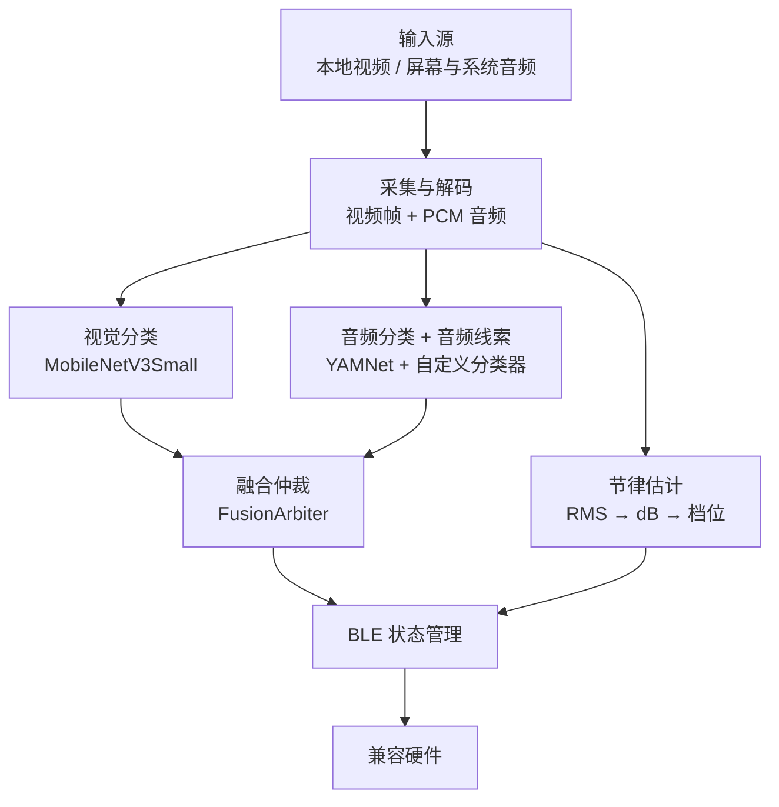

# Xcup Android

**中文** | [English](README.en.md)

一个运行在 Android 端的实时视频理解与 BLE 联动项目。

Xcup Android 会从本地视频或屏幕共享中提取画面与音频，在设备端识别动作状态和节律强度，经过融合仲裁与状态管理后，将控制指令发送给兼容的 BLE 硬件。iOS 版 [Xcup iOS](https://github.com/Tingfu-Zhou/Xcup-ios) 由本项目移植而来。

本项目最初作为个人项目开发。随着类似的视频互动能力逐渐普及，我决定公开代码，供对 Android 多媒体处理、端侧多模态推理和 BLE 实时控制感兴趣的开发者学习、研究与二次开发。

> 本项目涉及成人内容识别场景，仅面向成年人。请在遵守当地法律、内容授权、隐私保护和第三方平台规则的前提下使用。

## 功能概览

- 本地视频分析：从系统文件选择器导入视频，播放过程中同步分析画面与音频。
- 在线分析（Android 10+）：通过 `MediaProjection` 和 `AudioPlaybackCapture` 获取屏幕画面及其他应用允许捕获的播放音频；截屏先去掉视频四周的黑边，截图尺寸跟着转屏。
- 端侧视觉推理：MobileNetV3Small（LiteRT）识别剧情、口部动作和性交动作三类画面；每帧按训练素材的方式预处理（居中裁正方形 → 224 → 160）。
- 端侧音频推理：YAMNet + 自定义分类器识别动作类别；同一次推理还读取 YAMNet 自带的 AudioSet 521 类分数，判断这一刻的音频线索（对白、音乐、安静、听不出、人声、拍打等）。
- 节律强度估计：根据 PCM 音频的响度（RMS → dB）、时间平滑和置信度生成离散档位。
- 多模态融合（融合仲裁 `FusionArbiter` v2）：马达的启动、维持、停止分开判断，证据按新推理结果计数；启动要两路佐证或持续的音频证据，维持只要任一路有支持。启动时还参考音频线索：音频被背景音乐盖住时允许视频单独启动，视频确定是剧情时对白引起的音频误判不算启动证据。
- BLE 控制：自动扫描、连接、协议帧编解码、发送节流，以及硬件按键触发后的暂停与恢复。
- 手动电子菜单：直接选择变频模式（1–3）、马达强度（0–10 档）和紧急停止；要先在主页连上蓝牙才能进入。这里选的变频模式也用于视频分析模式。
- 定时加档（默认关闭）：分析累计运行满设定时间（1–30 分钟）后，发给设备的档位自动 +1 / +2；暂停、静音时不计时。
- 播放同步：支持拖动、暂停、恢复、播放结束处理和横屏全屏；Seek 后会重置历史状态并重新同步分析链路。
- 应用更新检查：通过远端 `version.json` 判断推荐更新或强制更新，并跳转外部浏览器下载。
- 多语言界面：中文、日语与英语，按系统语言自动切换。
- 上架准备：首次启动的 18+ 确认、主页底部的隐私政策入口，适配 Android 15 起强制的全屏绘制（edge-to-edge）。
- 评测模式：debug 包自动把每个融合 tick 写进评测 CSV（`BenchLogger`），配合 `bench/` 工具离线评估。

> 网页视频模式（应用内 WebView 嗅探网页视频地址，再交给 ExoPlayer 播放分析）已在上架 Google Play 前移除，最后一版代码在提交 `c06b84c`（tag `web-video-archive`），需要时用 `git checkout web-video-archive -- <文件>` 取回。

## 工作原理



系统主要由三个并行工作链路组成：

1. 视频链路每 250ms 按播放位置取一帧（离线模式在单独的抽帧线程里解码），预处理后放进 12 帧时序窗口，每 500ms 执行一次 MobileNetV3Small 推理。
2. 音频链路把音频下混、抗混叠重采样为 16 kHz（`PcmResampler`），每秒从环形缓冲区读取最近 2 秒（32,000 点）执行 YAMNet 推理并判音频线索（`AudioCue`），同时估计节律强度。
3. 融合链路每 500ms 读取最新结果，过滤超过 2 秒的旧数据，由 `FusionArbiter` 决定本 tick 的动作，再交给 BLE 状态管理器（确认稳定、最短驻留、发送节流）发送。

所有模型推理和音频解码均在后台线程完成；线程之间主要使用 `AtomicReference`、`AtomicBoolean` 和同步块交换状态。

## 核心组件

| 组件 | 作用 |
| --- | --- |
| `MainActivity.java` | 主界面、视频选择、BLE 连接、在线分析与手动菜单入口、18+ 确认、隐私政策和更新检查 |
| `VideoProcessActivity.java` | 本地视频播放、音视频分析、结果融合和 BLE 控制 |
| `OnlineAnalysisActivity.java` | 在线分析界面，复用本地模式的推理与融合逻辑 |
| `OnlineAnalysisService.java` | 前台服务；屏幕捕获（截图尺寸跟着转屏）、系统音频采集、静音检测和数据回调 |
| `ManualControlActivity.java` | 手动电子菜单：变频模式、强度、紧急停止、恢复控制和定时加档设置 |
| `FusionArbiter.java` | 融合仲裁：根据两路的新推理结果（音频带线索）决定马达的启动、维持与停止，两种模式共用 |
| `AudioCue.java` | 音频线索：AudioSet 分数按含义分组求和，判对白 / 音乐 / 安静 / 听不出 / 人声 / 拍打 / 其它 |
| `LevelBoost.java` | 定时加档的计时与加档 |
| `VideoFrameExtractor.java` | 基于 MediaExtractor、MediaCodec 与 SurfaceTexture 顺序解码，按播放位置取当前帧（在单独的抽帧线程里运行） |
| `EGLRenderer.java` | 使用 OpenGL/EGL 按 SurfaceTexture 的变换矩阵把画面中央的正方形画到离屏缓冲并读回 |
| `FramePreprocessor.java` | 视频模型输入的预处理（居中裁剪、面积平均缩小到 160×160），与训练素材的处理一致，两种模式共用 |
| `ScreenCropper.java` | 在线模式：在截屏里找出视频画面（去掉四周对称的黑边），再交给 `FramePreprocessor` 居中裁剪 |
| `VideoClassifierHelper.java` | MobileNetV3Small 推理封装（LiteRT） |
| `AudioDecoder.java` | 按播放进度解码音频（限速、Seek），交给 `PcmResampler` 后写入 PCM 环形缓冲区 |
| `PcmResampler.java` | 流式下混与抗混叠重采样到 16 kHz，与训练数据的 ffmpeg 处理一致 |
| `PcmCircularBuffer.java` | 管理本地与在线模式的 PCM 数据写入和窗口读取 |
| `AudioInferenceHelper.java` | YAMNet 特征提取与自定义音频分类器推理；同一次推理取 AudioSet 521 类分数 |
| `AudioLoudnessLevelEstimator.java` | 音频响度、时间平滑、置信度与离散档位估计 |
| `BLEManager.java` | BLE 扫描、连接、协议帧编解码与控制状态管理 |
| `BenchLogger.java` | 评测数据采集（debug 包自动开启），每个融合 tick 写一行 CSV |
| `SystemBarInsets.java` | 让内容避开状态栏、导航栏和挖孔区域（Android 15 edge-to-edge） |
| `UpdateChecker.java` | 拉取版本配置并判断推荐更新或强制更新 |

## 模型规格

### 视频模型

- 骨干网络：MobileNetV3Small + Temporal Average Pooling + 三分类器（2026-10-18 起为按新训练配方重训的 E1d 版，结构和输入输出不变）
- 模型文件：`mobilenetv3small_tap_3class_float32.tflite`
- 输入：`[1, 12, 160, 160, 3]`，`float32`，NHWC，RGB
- 像素范围：`0-255`，模型内部包含 Rescaling，不应再次归一化
- 预处理：居中裁正方形 → 面积平均缩到 224 → 再缩到 160，与训练素材一致
- 输出：`normal_plot`、`oral`、`sex` 三类 softmax 概率
- 推理配置：LiteRT，CPU，4 线程

### 音频模型

- 特征提取：预训练 YAMNet
- 分类器：面向当前任务微调的三分类模型（`sex`、`oral`、`noise`）
- 输入：2 秒、16 kHz、单声道 PCM，共 32,000 个 `float` 采样点
- 输出：动作类别、置信度与时间戳；另有 YAMNet 自带的 AudioSet 521 类分数（4 帧平均），用来判音频线索

第三方预训练模型与相关资源仍受各自许可证和使用条款约束。自定义模型是否随仓库提供，请以 `app/src/main/assets/` 中的实际文件为准。

## 开始使用

### 环境要求

- Android Studio，JDK 17（AGP 8.9.1 的要求），`compileSdk` / `targetSdk` 36
- 支持 BLE 的 Android 真机，Android 8.0（API 26）及以上；在线分析需要 Android 10 及以上
- 与目标硬件一致的 BLE 服务和特征 UUID

模拟器通常无法完整验证 BLE、屏幕投影、系统播放音频捕获和实际性能，建议使用真机调试。

### 1. 获取代码

将本仓库克隆或下载到本地，然后使用 Android Studio 打开项目根目录。

### 2. 准备模型

确认推理所需的 TFLite 模型已放入 `app/src/main/assets/`：`mobilenetv3small_tap_3class_float32.tflite`（视频）、`yamnet.tflite` 和 `yamnet_finetuned.tflite`（音频），文件名应与代码中的加载路径一致。

### 3. 配置 BLE

在 `BLEManager.java` 或对应配置文件中填写实际硬件参数：

- `TARGET_NAME_PREFIX`
- Service UUID
- Characteristic UUID
- 指令帧格式与档位映射

仓库中的默认值未必适用于其他硬件。错误的协议、方向或档位映射可能导致设备行为异常，请先在低强度和空载状态下测试。

### 4. 配置更新地址（可选）

如需启用应用更新检查，请将固定地址的 `version.json` 配置为类似结构（Android 读 `android` 段，iOS 版读同一文件的 `ios` 段）：

```json
{
  "android": {
    "latestVersionCode": 108,
    "minSupportedCode": 106,
    "latestVersionName": "1.0.8",
    "landingUrl": "https://example.com/download",
    "notes": "修复问题并提升性能",
    "notes_ja": "不具合の修正とパフォーマンスの向上",
    "notes_en": "Bug fixes and performance improvements"
  }
}
```

`notes_ja`、`notes_en` 可选：界面是日文时更新弹窗显示 `notes_ja`，没填就显示 `notes`；界面是英文时显示 `notes_en`，没填就不显示说明（不显示中文的 `notes`）。iOS 段同样支持这两个字段。

### 5. 构建、测试与安装

在 Android Studio 中完成 Gradle Sync 后运行 `app`，或执行：

```bash
./gradlew assembleDebug
```

单元测试（`FusionArbiterTest`、`AudioCueTest`、`PcmResamplerTest`、`FramePreprocessorTest`、`ScreenCropperTest`、`LevelBoostTest`）用 `bench/tools/` 里 Python 版生成的对拍数据，校验 Java 实现逐位、逐 tick 一致：

```bash
./gradlew testDebugUnitTest
```

首次使用时，根据 Android 版本授予蓝牙、通知、录音和屏幕投影等必要权限。

## 评测与训练

- `bench/`：评测基准，包括人工标注、采集评测 CSV、计算误转 / 漏转 / 误停等指标、融合仲裁的离线回放与调参、视频抽帧和音频处理的离线重算。详见 [bench/README.md](bench/README.md)。
- `training/`：视频模型的训练脚本与配方（E1d）。详见 [training/README.md](training/README.md) 和 [training/RECIPE.md](training/RECIPE.md)。
- 改融合规则、音频线索或预处理时，Java 实现和 `bench/tools/` 里对应的 Python 版要一起改，重新生成对拍数据后再跑单元测试；iOS 版用同一份对拍数据校验。

## 发布到 Google Play

Android 版只维护一版：同一个包既上架 Google Play，也放在自己的服务器上供直接下载。

- 包名（`applicationId`）是 `com.aibei.Xcup`（与 iOS 版的 Bundle ID 一致，区分大小写），上架后不能再改。2026-10 之前的版本包名是 `com.example.helloworld`（Play 不接受 `com.example` 开头），
  两者是两个 app，老用户需要卸载旧版再装新版。Java 包名（`namespace`）没有改，仍是 `com.example.helloworld`。
- `targetSdk` / `compileSdk` 为 36（Play 从 2026-08-31 起要求新应用和更新 target Android 16），AGP 至少 8.9.1。
- 推理运行时用 LiteRT（`com.google.ai.edge.litert:litert`），它的 `.so` 按 16 KB 对齐；Play 要求 target 35+ 的 app 支持 16 KB 内存页。
  打包后用 Android Studio 的 APK Analyzer（`lib/arm64-v8a` 的 Alignment 列）或 `zipalign -c -P 16 -v 4 <apk>` 检查。
- 上传 Play 用 AAB（Build → Generate Signed App Bundle），并开启 Play App Signing。开启时选择上传自己现有的签名密钥，
  这样服务器上直接下载的 APK 和 Play 装的签名一致，用户可以在两个渠道之间覆盖升级。
- Play 上的 app 只能通过 Play 更新：`UpdateChecker` 弹窗跳转外部下载的更新方式，对 Play 审核有风险，上架前要再处理。

## 多语言

界面文字支持中文、日语和英语，按系统语言自动切换：按系统语言列表的顺序，取第一个本 App 支持的语言；三种都不在列表里时显示中文。

- 中文：`app/src/main/res/values/strings.xml`（默认，也是其他语言的兜底）
- 日语：`app/src/main/res/values-ja/strings.xml`
- 英语：`app/src/main/res/values-en/strings.xml`
- `app/src/main/res/xml/locales_config.xml`：声明支持的语言，Android 13 及以上可在「系统设置 → 应用 → 语言」里单独为本 App 选择语言

新增界面文字时，在 `values/strings.xml`、`values-ja/strings.xml`、`values-en/strings.xml` 里各加一条同名的字符串，代码里用 `R.string.xxx` / `getString(...)`，不要直接写中文字面量。带参数的文字用 `%1$d`、`%2$s` 这类带序号的占位符，日语、英语语序不同也能对上。只在调试悬浮窗和日志里出现的文字不需要翻译。

英文按北美用法，与 iOS 版一致：按钮和标题用 Title Case（如 Emergency Stop），提示句只有句首大写；撇号和引号用 ’ “ ”（直撇号 ' 在 strings.xml 里要转义）。

## 使用流程

### 本地视频

1. 在主界面连接 BLE 设备。
2. 选择本地视频文件。
3. 播放视频，应用会自动启动音视频分析与 BLE 联动。
4. 暂停、拖动或退出播放时，应用会暂停分析并发送停止状态；恢复后重新同步。

### 在线分析

1. 进入在线分析模式，依次授予录音（用于抓取系统播放的声音，不使用麦克风）、通知（可选）和屏幕捕获权限。
2. 返回桌面，在其他应用中播放允许捕获的视频。横屏全屏播放时，截到的画面与训练素材的取法一致，识别效果最好。
3. 应用以前台服务持续获取屏幕帧和系统音频；连续静音约 5 秒时暂停分析并让硬件停止，声音恢复后继续。
4. 返回 App 主页面即可退出在线模式，也可以在系统的屏幕共享提示里点「停止」。

### 手动控制

1. 在主界面连接 BLE 设备后进入「手动电子菜单」。
2. 选择变频模式、拖动强度滑杆，或点「紧急停止」。
3. 设备被本地按键锁定时，可在这里点「恢复控制」；定时加档也在这里打开。

## 性能参考

以下为开发阶段的单次测试结果，仅用于说明量级；不同 SoC、Android 版本、视频分辨率和温控状态会显著影响结果。抽帧耗时是旧版实现在主线程上测得的，2026-10-14 起抽帧移到单独的线程，不再占用主线程。

| 项目 | 参考耗时 |
| --- | ---: |
| 视频帧提取 | 约 43.54 ms |
| MobileNetV3Small 推理 | 约 110 ms |
| 视频抽帧到推理完成 | 约 154 ms |
| YAMNet 音频推理 | 约 65 ms |
| 音频节律估计 | 约 3 ms |

## 已知限制

- `AudioPlaybackCapture` 只能捕获目标应用明确允许捕获的音频；受保护内容可能静音或黑屏。
- 在线模式去黑边时，片源自带的对称黑边也会被裁掉；背景不是纯黑的播放器不裁。
- 在线模式不写评测 CSV，音频线索在录屏音频上还没有用真机数据评估过。
- BLE 协议和档位映射与具体硬件绑定，不能直接保证兼容其他设备。
- 分类结果依赖训练数据分布，不应将模型输出视为对内容的绝对判断。
- 当前性能数据来自开发阶段测试，不代表所有设备上的实时性或稳定性。

## 隐私与合规

- 音视频识别链路设计为端侧推理；如二次开发中加入日志上传、统计分析或云端推理，应明确告知用户并取得必要授权。
- 仅分析你有权访问和处理的内容，不得处理涉及未成年人、偷拍、胁迫或其他违法内容。
- 屏幕捕获和音频捕获应遵守当地法律、内容版权及目标应用的服务条款。
- 隐私政策：与 iOS 版共用 `https://download.xswy.tech/privacy.html`（主页底部和首次启动的 18+ 确认弹窗里有入口，地址见 `MainActivity.PRIVACY_POLICY_URL`；Play Console 也填这个地址）。改了权限或数据处理方式，要同时更新它和 Play Console 的“数据安全”表。
- 接入实体硬件前请增加强度上限、停止指令、连接异常处理和人工中止机制，并充分测试。

## 贡献

欢迎提交 Issue 和 Pull Request。提交改动时建议：

- 说明 Android 版本、设备型号和复现步骤。
- 将模型调整、BLE 协议和通用播放器改动拆分为独立提交。
- 不要提交无权公开的视频、音频、训练数据、密钥、签名文件或设备唯一标识。
- 对涉及线程、Seek、暂停恢复或 BLE 状态机的改动补充真机测试结果。

## 蓝牙协议

本项目通过 BLE 与 Xcup 硬件进行通信。关于第一批 Xcup 硬件使用的 BLE 通信协议、相关资料与参考实现，请参阅：

* [Xcup Bluetooth Protocol](https://github.com/Tingfu-Zhou/Xcup-Bluetooth-protocol)

不同硬件批次或固件版本使用的协议可能存在差异。进行硬件适配时，请以目标设备的实际固件和协议版本为准。

## 相关项目

- [Xcup iOS](https://github.com/Tingfu-Zhou/Xcup-ios)：由本项目移植的 iOS 版
- [Xcup Bluetooth Protocol](https://github.com/Tingfu-Zhou/Xcup-Bluetooth-protocol)：第一批硬件使用的 BLE 协议资料与参考实现

## 许可证

本项目源代码采用 [Apache License 2.0](LICENSE) 开源。你可以在遵守许可证条款的前提下使用、修改和分发本项目代码，包括将其用于商业项目。

第三方依赖、预训练模型、自定义模型权重、训练数据及其他资源不一定适用 Apache License 2.0，应分别遵守其各自的许可证和使用条款。

Apache License 2.0 不授予对 Xcup 名称、商标、产品图片、Logo 或其他品牌资产的使用权。

## 致谢

- [LiteRT / TensorFlow Lite](https://developers.google.com/edge/litert)
- [MobileNetV3Small](https://www.tensorflow.org/api_docs/python/tf/keras/applications/MobileNetV3Small)
- [YAMNet](https://www.tensorflow.org/hub/tutorials/yamnet)
- [Android MediaProjection](https://developer.android.com/media/grow/media-projection)
- [Android Audio Playback Capture](https://developer.android.com/media/platform/av-capture)
- [Android BLE](https://developer.android.com/develop/connectivity/bluetooth/ble/ble-overview)

---

如果这个项目对你有帮助，欢迎 Star、提交反馈，或分享你的改进方案。我的个人QQ：3247499719
